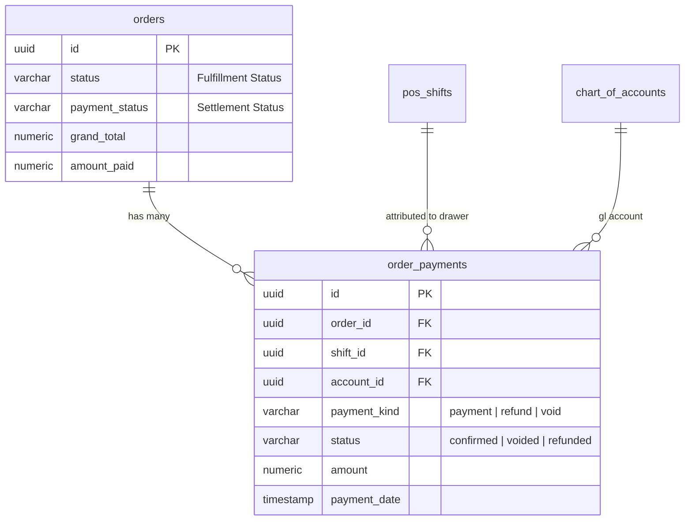

# Two-Dimensional Order Lifecycle & Omnichannel Settlement Architecture

## 1. Teori Pemisahan Dua Dimensi (Dual State Machine Theory)

Dalam rekayasa perangkat lunak *Enterprise Resource Planning* (ERP) dan perdagangan multi-saluran (*Omnichannel Commerce*), memperlakukan status pesanan sebagai satu dimensi linear tunggal (misalnya `pending -> processing -> shipped -> completed`) adalah sebuah **cacat arsitektural (*architectural flaw*)**. 

Status pesanan pada dasarnya terdiri dari dua ruang keadaan ortogonal (*orthogonal state spaces*):

```
                        STATUS PESANAN OMNICHANNEL
             ┌──────────────────────────────────────────────┐
             │                                              │
             ▼                                              ▼
   [ Dimensi Logistik / Pemenuhan ]              [ Dimensi Finansial / Settlement ]
     orders.status                                 orders.payment_status
     • pending (menunggu)                          • unpaid (belum lunas)
     • processing (diproses)                       • partial (cicilan / DP)
     • shipped (dikirim)                           • paid (lunas)
     • completed (selesai diterima)
     • cancelled (dibatalkan)
```

### Mengapa Mengikat Lunas ke `status === 'completed'` Berbahaya?
1. **Kegagalan Representasi Non-COD:** Pada transaksi online (Transfer Bank BCA/Mandiri, QRIS, Virtual Account, Kartu Kredit), pelanggan mentransfer uang **sebelum** paket dikemas. Ketika kurir mengambil paket dan status logistik berubah menjadi `shipped`, kas telah mengendap di rekening bank perusahaan. Jika status finansial baru dianggap `paid` saat `completed`, sistem akan salah menampilkan pesanan sebagai `BELUM BAYAR` dan mencatatkan piutang palsu di neraca keuangan.
2. **Kekacauan Rekonsiliasi Kasir:** Kasir atau manajer operasional tidak dapat membedakan mana pesanan yang aman dikirim (karena sudah lunas di muka) dan mana pesanan yang membawa risiko penagihan (seperti COD atau pembayaran termin/tempo).

---

## 2. Omnichannel Settlement: Non-COD vs COD Dynamics

Dalam akuntansi modern dan standar e-commerce kelas dunia, pengakuan kas dan piutang dibedakan secara tegas berdasarkan metode tender:

| Karakteristik | Pesanan Non-COD (Transfer / Gateway / QRIS) | Pesanan COD (Bayar di Tempat) |
| :--- | :--- | :--- |
| **Model Pembayaran** | *Upfront Payment* (Dibayar di Muka) | *Post-Delivery Collection* (Dibayar saat Diterima) |
| **Status Saat `processing`** | `paid` (Kas diakui di jurnal) | `unpaid` (Piutang COD diakui di jurnal) |
| **Status Saat `shipped`** | `paid` (Piutang: Rp 0) | `unpaid` (Piutang kurir ekspedisi aktif) |
| **Status Saat `completed`** | `paid` | `paid` (Remitansi kas kurir disetor) |
| **Pemicu `paid` Otomatis** | `processing`, `shipped`, `completed`, atau `date_paid != null` | Hanya saat `completed` |

### Rantai Logika Settlement di `lib/orderLedger.ts`:
```typescript
const paymentMethod = (order.payment_method || '').toLowerCase()
const isCOD = paymentMethod.includes('cod') || paymentMethod.includes('bayar di tempat')
const hasDatePaid = Boolean(order.raw_source_data?.date_paid)
const isPaidStatus = ['processing', 'shipped', 'completed'].includes(order.status)

// Non-COD yang sedang diproses / dikirim adalah LUNAS
const isOrderPaid = (!isCOD && (isPaidStatus || hasDatePaid)) || (isCOD && order.status === 'completed')
```

---

## 3. World-Class Performance: High-Speed Database RPC (Zero N+1)

Menampilkan status pembayaran pada daftar ribuan pesanan tidak boleh dilakukan dengan melakukan komputasi per baris di sisi JavaScript (Client-side N+1), karena akan menyebabkan *layout shift*, lag antarmuka, dan pemborosan bandwidth.

### Arsitektur RPC PostgreSQL:
1. Kolom `o.payment_status` dan `COALESCE(o.amount_paid, 0)` diproyeksikan langsung dari basis data dalam fungsi RPC `get_order_list`.
2. Didukung indeks komposit terindeks B-Tree:
   ```sql
   CREATE INDEX IF NOT EXISTS idx_orders_business_payment_status 
   ON public.orders (business_id, payment_status, created_at DESC);
   ```
3. Penyaringan multi-status dieksekusi secara instan di level *database engine* melalui klausa array:
   ```sql
   AND (filter_payment_status IS NULL OR o.payment_status = ANY(filter_payment_status))
   ```
4. Agregasi analitik pada kartu metrik (`get_order_analytics_metrics`) menghitung total piutang belum tertagih (`unpaid_amount` dan `unpaid_count`) dalam *single round-trip query*, tanpa memuat seluruh baris transaksi ke memori Node.js.

---

## 4. Single Source of Truth: `order_payments` Ledger

Tabel `order_payments` bertindak sebagai buku besar arus kas masuk (*Cash Receipt Ledger*) dengan relasi 1:N terhadap tabel `orders`:



### Prinsip Idempotent Auto-Population di Orchestrator (`syncOrderToLedger`):
Jika pesanan diakui lunas (`isOrderPaid`), sistem melakukan verifikasi ke tabel `order_payments`:
- Jika belum ada baris pembayaran (misalnya pesanan dari webhook luar atau sinkronisasi historis), orchestrator menyisipkan baris pembayaran otomatis (`payment_kind: 'payment'`, `status: 'confirmed'`, `amount: grand_total`).
- Status pesanan disinkronkan secara atomik: `payment_status = 'paid'`, `amount_paid = grand_total`.
- Hal ini menjamin tab **Riwayat Pembayaran** pada `OrderDetailModal.tsx` selalu menyajikan data lengkap tanpa rekaman piutang semu (*orphan records*).

---

## 5. Panduan Implementasi untuk Pengembang (Rules of Thumb)

1. **Jangan Pernah Mengandalkan `orders.status` untuk Menilai Keuangan:**
   Gunakan selalu `orders.payment_status` (`paid`, `partial`, `unpaid`) dan `orders.amount_paid`.
2. **Timezone-Aware Visuals:**
   Semua stempel waktu pembayaran wajib diformat menggunakan `formatDisplayDate(date, mode, businessTimezone)` dari `@/lib/timeUtils.ts`.
3. **Null-Safety pada Async Closures:**
   Saat memuat data `order_payments` di komponen React, ekstrak selalu `const orderId = order?.id` secara sinkronus sebelum memanggil `fetch()` di dalam `useEffect`.
4. **Append-Only Auditing:**
   Dilarang melakukan `DELETE` pada baris pembayaran. Pembatalan dilakukan via fungsi `voidOrderPayment()` dari `@/lib/paymentLedger.ts`.
