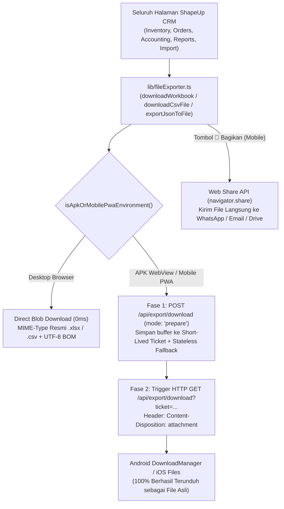

# Arsitektur Universal File Download & Export Engine (APK WebView, PWA & Desktop) — ShapeUp CRM

Dokumen knowledge ini menetapkan standar arsitektur teknis untuk seluruh fitur **Download Template** dan **Export Laporan (`.xlsx` / `.csv`)** di ShapeUp CRM agar berjalan 100% andal di **Android APK WebView**, **Standalone Mobile PWA (Android WebAPK / iOS Home Screen)**, maupun **Desktop Browser**.

---

## 1. Akar Masalah: Mengapa `XLSX.writeFile` & `blob:` URL Gagal di APK / Mobile WebView?

Secara default, fungsi `XLSX.writeFile(wb, fileName)` dari pustaka SheetJS atau fungsi `downloadCsv` manual di sisi browser bekerja dengan cara:
1. Membuat objek memori `new Blob([data], { type: "application/octet-stream" })`.
2. Membuat skema URL lokal `blob:https://domain/...` menggunakan `URL.createObjectURL(blob)`.
3. Menyuntikkan elemen `<a href="blob:..." download="file.xlsx">` dan memanggil `a.click()`.

Pada lingkungan **APK Android (WebView / Capacitor / Web-to-APK Wrapper)** dan beberapa **Standalone Mobile PWA**, mekanisme tersebut **gagal total (*silent fail* atau error unduhan)** karena 3 batasan sistem operasi:
1. **Ketidakmampuan Android `DownloadManager` Membaca Skema `blob:`:**
   Ketika WebView menangkap event unduhan melalui `DownloadListener.onDownloadStart(url, ...)`, WebView menyerahkan URL tersebut ke layanan sistem operasi Android `android.app.DownloadManager`. `DownloadManager` adalah proses sistem terpisah di luar memori JavaScript WebView yang **HANYA** menerima protokol jaringan `http://` atau `https://`, sehingga langsung menolak atau gagal mengunduh URL `blob:`.
2. **Keterbatasan `DownloadManager.Request(Uri)` yang Hanya Mendukung HTTP `GET`:**
   `DownloadManager` di Android mengambil berkas menggunakan metode HTTP `GET` murni. Jika unduhan hanya dipicu oleh response `POST`, `DownloadManager` akan melakukan request ulang ke URL tersebut menggunakan `GET` tanpa body `POST`, sehingga gagal jika server tidak menyediakan handler `GET`.
3. **Penolakan MIME-Type Generik `application/octet-stream`:**
   Banyak APK wrapper memblokir atau gagal memetakan ekstensi file jika MIME-type tidak spesifik (`application/vnd.openxmlformats-officedocument.spreadsheetml.sheet` untuk `.xlsx` atau `text/csv; charset=utf-8` untuk `.csv`).

---

## 2. Arsitektur Solusi: Universal 3-Layer Download & Share Engine

Untuk menyelesaikan masalah ini di seluruh halaman sekaligus tanpa duplikasi kode, seluruh fitur ekspor dan unduh wajib melalui modul terpusat:

### Lapisan 1: Endpoint Relay HTTP Two-Phase `POST` $\rightarrow$ `GET` ([app/api/export/download/route.ts](file:///home/faiz-jazuli/shapeup-crm/app/api/export/download/route.ts))
- **`POST /api/export/download` (`mode: 'prepare'`):**
  Menerima payload Base64 dari client, menyimpannya ke dalam *Short-Lived Ticket Cache* (`TTL 2 menit`), dan mengembalikan `downloadUrl` bertipe HTTP `GET` (`/api/export/download?ticket=...&fileName=...`). Untuk file berukuran kecil ($\le 12\text{KB}$), parameter `payload` juga disertakan di query string sebagai *stateless serverless fallback*.
- **`GET /api/export/download?ticket=...`:**
  Mengalirkan binary file dengan header resmi RFC 5987:
  - `Content-Type: application/vnd.openxmlformats-officedocument.spreadsheetml.sheet` (atau `text/csv; charset=utf-8`)
  - `Content-Disposition: attachment; filename="Nama_File.xlsx"; filename*=UTF-8''Nama_File.xlsx`
  - `Content-Length: <byteLength>`
  - Karena merupakan URL `https://` dengan metode `GET`, **Android `DownloadManager` pada APK dapat mengunduhnya 100% tanpa kendala** dan tanpa me-reload halaman React SPA yang sedang dibuka.

### Lapisan 2: Helper Utilitas Terpusat ([lib/fileExporter.ts](file:///home/faiz-jazuli/shapeup-crm/lib/fileExporter.ts))
**DILARANG KERAS** memanggil `XLSX.writeFile(...)` atau membuat `URL.createObjectURL(blob)` manual di komponen halaman. Gunakan fungsi standar berikut dari `@/lib/fileExporter`:
1. **`downloadWorkbook(workbook, fileName, options?)`**:
   - *Drop-in replacement* untuk `XLSX.writeFile(wb, fileName)`.
   - Otomatis mendeteksi lingkungan (`isApkOrMobilePwaEnvironment()`): menggunakan Blob instan (`0ms`) di Desktop, dan otomatis beralih ke Two-Phase HTTP `GET` Relay di APK/PWA.
   - Otomatis menghitung lebar kolom (`calculateAutoColumnWidths`) agar file Excel tidak sempit/terpotong saat dibuka.
2. **`downloadCsvFile(fileName, headers, rows, options?)`**:
   - *Drop-in replacement* untuk unduhan CSV.
   - Otomatis menyematkan **UTF-8 BOM (`\uFEFF`)** di awal file agar Microsoft Excel di HP maupun PC langsung mengenali pemisah kolom dan karakter UTF-8 dengan benar.
3. **`exportJsonToFile({ sheets, fileName, format })`**:
   - Helper tingkat tinggi untuk membuat dan mengunduh file `.xlsx` (single/multi-sheet) atau `.csv` langsung dari array objek JSON dalam 1 baris pemanggilan.
4. **`shareOrDownloadWorkbook(workbook, fileName, options?)`**:
   - Membuka **Native Mobile Share Sheet (`navigator.share({ files })`)** pada perangkat Android/iOS sehingga pengguna dapat langsung mengirim file laporan ke **WhatsApp, Telegram, Email, atau Google Drive** tanpa perlu mencari file di folder *Downloads*.

### Lapisan 3: Modal Ekspor Universal ([components/ui/UniversalExportModal.tsx](file:///home/faiz-jazuli/shapeup-crm/components/ui/UniversalExportModal.tsx))
- Berbasis `FullScreenModal` (mematuhi standar `mobile-modal-ux` & *One-Time Transition Guard* `prevIsOpenRef`).
- Menyediakan pilihan **Cakupan Data (Scope)**, pilihan format **Excel (`.xlsx`)** vs **CSV (`.csv`)**, indikator *progress bar*, tombol **📥 Unduh Berkas Sekarang**, dan tombol **📲 Bagikan** (otomatis tampil di perangkat yang mendukung `canUseNativeFileShare()`).

---

## 3. Standar Ekspor Laporan Inventory & Stok (`/inventory/reports`)

Pada modul Laporan Inventory ([InventoryReportsMain.tsx](file:///home/faiz-jazuli/shapeup-crm/plugins/inventory-reports/components/InventoryReportsMain.tsx) & [app/api/inventory/reports/route.ts](file:///home/faiz-jazuli/shapeup-crm/app/api/inventory/reports/route.ts)):
1. **Full Catalog Chunked Export (`action=export_stock`):**
   Ekspor stok tidak boleh hanya mengekspor 25 baris paginasi di layar. Pilihan *"Seluruh Katalog Stok Produk & Varian"* memanggil `/api/inventory/reports?action=export_stock` yang menarik seluruh produk secara bertahap (kelipatan 1.000 baris untuk melewati batas `PGRST_MAX_ROWS = 1000`).
2. **Discrete Physical SKU Unfolding (`formatDiscreteStockRows`):**
   Sesuai standar `inventory-ledger` §7.3, produk yang memiliki variasi (`product_variants`) wajib dibentangkan (*unfolded*) menjadi baris SKU fisik mandiri (`${productName} - ${variant.name}`) dengan SKU, stok fisik (`onHandQty`), HPP modal (`unitCost`), dan total nilai persediaan masing-masing.
3. **Context-Aware Multi-Tab Export:**
   Tombol **Export Excel / CSV** menyesuaikan struktur laporan secara otomatis berdasarkan tab yang sedang aktif:
   - `stock`: Daftar Stok Persediaan SKU & Varian Diskret.
   - `location`: Distribusi Persediaan per Lokasi & Gudang.
   - `analysis`: Buku kerja 2-Sheet (*Pivot Analisis Produk* & *Riwayat Mutasi Stok*).
   - `valuation`: Perbandingan penilaian finansial **FIFO, AVCO, LIFO, dan Standard Cost** per SKU.
   - `returns`: Daftar Audit Karantina Retur beserta status verifikasi gudang.

